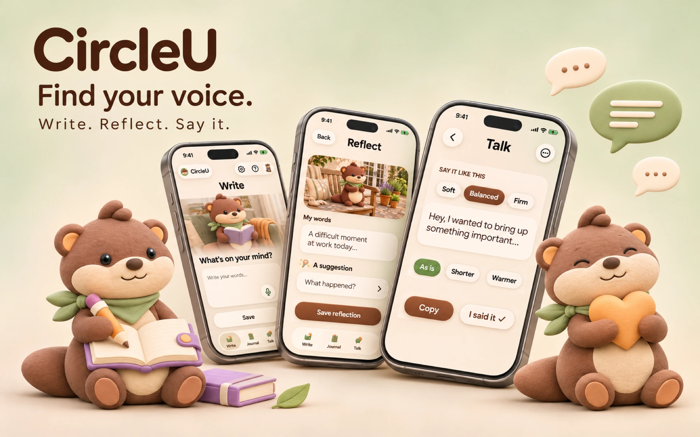
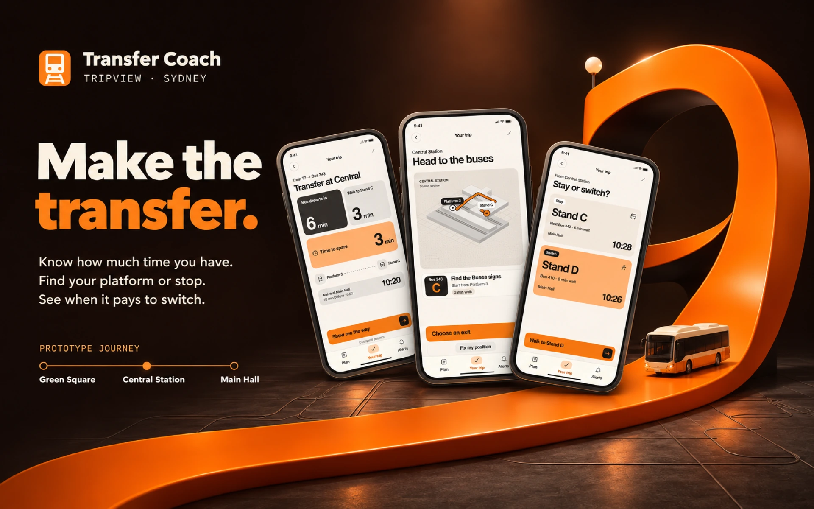
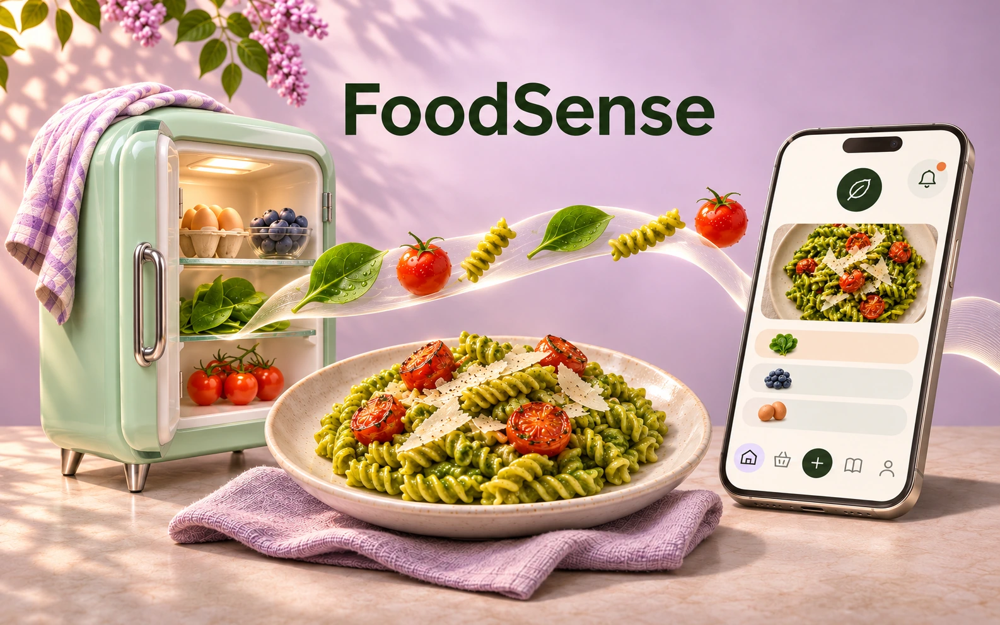

<strong>EN</strong> · <a href="README.zh-CN.md">中文</a>

# Shangcheng Lin (Katherine)

**AI product design · UX research · Interaction design · Creative development**

**[Open the live portfolio](https://katherine0292.github.io/portfolio/)** · [Deployment guide](docs/DEPLOYMENT.md)

I design experiences that help people act when information is uncertain, an interface gets in the way, or a routine breaks. My work connects research, interaction design and working prototypes, from private reflection on an iPhone to explainable creatures in the browser.

This portfolio brings together **eight projects**, including four independent freelance commissions: Wildling, FoodSense, Transfer Coach and Data Visualisation. Each case study explains the problem, my contribution, the design decisions, the evidence and the current delivery stage.

[GitHub profile](https://github.com/katherine0292) · [All projects](#selected-projects) · [Skills and evidence](#skills-and-evidence) · [Source register](docs/SOURCES.md)

## Where to start

| If you are reviewing… | Start with… |
| --- | --- |
| AI product design and trust | [CircleU](projects/circleu.md), [Wildling](projects/wildling.md), [Data Benchmark](projects/who-said-what-when.md) |
| UX, accessibility and recovery | [MusicTag](projects/musictag.md), [Transfer Coach](projects/transfer-coach.md), [FoodSense](projects/foodsense.md) |
| Research and evidence communication | [HCI Research](projects/hci-research.md), [Data Visualisation](projects/data-visualisation.md) |

## Selected projects

<table>
<tr>
<td width="50%" valign="top">

<h3>CircleU</h3>

A reflection and communication-practice app for difficult conversations, built on Apple&#x27;s on-device foundation models.

<strong>Context:</strong> Apple Foundation Program, Sydney · 5-person team, Apple mentors <strong>My role:</strong> Product lead (PM &amp; UX): research, MVP scope, AI design, release <strong>Stage:</strong> TestFlight 1.0 (first release): 6 installs, 143 sessions

<a href="https://katherine0292.github.io/CircleU/">Portfolio</a> · <a href="https://github.com/katherine0292/CircleU">Repository</a>

</td>
<td width="50%" valign="top">

<h3>Wildling</h3>

A browser installation where visitors care for three kittens by hand gesture, and each kitten&#x27;s decisions are explained in real time.

<strong>Context:</strong> Independent commission for Stamp Gallery, a private gallery <strong>My role:</strong> Sole designer and developer <strong>Stage:</strong> Live · real-hand performance not yet measured

<a href="https://katherine0292.github.io/wildling/portfolio/">Portfolio</a> · <a href="https://katherine0292.github.io/wildling/">Play</a> · <a href="https://github.com/katherine0292/wildling">Repository</a>

</td>
</tr>
<tr>
<td width="50%" valign="top">

<h3>Transfer Coach</h3>

A decision layer for multi-transfer commutes: will I make the connection, and what do I do if I won&#x27;t?

<strong>Context:</strong> Independent commission for TripView, Sydney, 2026 <strong>My role:</strong> UX researcher and interaction designer (solo): research, concept, prototype, evaluation <strong>Stage:</strong> 38-screen prototype delivered · sample data, no live feed

<a href="https://katherine0292.github.io/Transfer-Coach/portfolio/">Portfolio</a> · <a href="https://github.com/katherine0292/Transfer-Coach">Repository</a>

</td>
<td width="50%" valign="top">

<h3>FoodSense</h3>

An iOS app that turns fridge-camera detections into a confirmed inventory and a meal the household can cook.

<strong>Context:</strong> Independent client commission; client not named in the public materials <strong>My role:</strong> UI/UX designer: interaction, visual design, prototypes <strong>Stage:</strong> Interactive prototype · detection data simulated

<a href="https://katherine0292.github.io/FoodSense/">Portfolio</a> · <a href="https://github.com/katherine0292/FoodSense">Repository</a>

</td>
</tr>
<tr>
<td width="50%" valign="top">

<h3>MusicTag</h3>

A simplified phone interface paired with a tactile remote, designed so older listeners can find and play familiar music on their own.

<strong>Context:</strong> University–industry collaboration with Spotify <strong>My role:</strong> UX and interaction design: research, prototype, voice spec, evaluation plan <strong>Stage:</strong> Interactive prototype · voice and Bluetooth simulated · usability study planned

<a href="https://katherine0292.github.io/MusicTag/">Portfolio</a> · <a href="https://github.com/katherine0292/MusicTag">Repository</a>

</td>
<td width="50%" valign="top">

<h3>HCI Research</h3>

A two-phase HCI study of how people keep track of belongings and resume interrupted routines, with design implications.

<strong>Context:</strong> HCI paper research in an academic setting, 2026 · Project: Remembering in Motion <strong>My role:</strong> Lead researcher: framing, interviews, analysis, probe design <strong>Stage:</strong> Two study phases complete · evaluation plan proposed

<a href="https://katherine0292.github.io/HCI-Research/">Portfolio</a> · <a href="https://github.com/katherine0292/HCI-Research">Repository</a>

</td>
</tr>
<tr>
<td width="50%" valign="top">

<h3>Data Benchmark</h3>

An audio question-answering evaluation pilot that tests whether systems get the speaker, meaning and time evidence right.

<strong>Context:</strong> Research paper forthcoming · Corresponding author · Project: Who Said What When <strong>My role:</strong> Corresponding author · task design, annotation, data validation and scoring tools <strong>Stage:</strong> Evaluation pilot · independent listening review pending

<a href="https://katherine0292.github.io/who-said-what-when-benchmark/">Portfolio</a> · <a href="https://github.com/katherine0292/who-said-what-when-benchmark">Repository</a>

</td>
<td width="50%" valign="top">

<h3>Data Visualisation</h3>

A data-driven story that turns international-student enrolment data into decisions a prospective student can act on.

<strong>Context:</strong> Independent commission for Harbourline Education Consulting · Project: The Price of Arrival <strong>My role:</strong> Data analysis, visualisation and storytelling, end to end <strong>Stage:</strong> 6 figures · 19-slide story · short film

<a href="https://katherine0292.github.io/Data-Visualisation/portfolio/">Portfolio</a> · <a href="https://github.com/katherine0292/Data-Visualisation">Repository</a>

</td>
</tr>
</table>

## Skills and evidence

| Capability | How it appears in the work |
| --- | --- |
| Research that changes a design | [HCI Research](projects/hci-research.md): interviews to a field probe; [Transfer Coach](projects/transfer-coach.md): evaluation findings to recovery flows. |
| AI interaction and user control | [CircleU](projects/circleu.md): source labels, fallbacks and editable suggestions; [FoodSense](projects/foodsense.md): review before adding detections. |
| Accessible, recoverable experiences | [MusicTag](projects/musictag.md): tactile controls, stable navigation, voice retry and typing; [Transfer Coach](projects/transfer-coach.md): alternatives at the point of failure. |
| Prototyping and implementation | [Wildling](projects/wildling.md): browser interaction and deterministic replays; [CircleU](projects/circleu.md): native iOS flows and local storage. |
| Evaluation and evidence quality | [Data Benchmark](projects/who-said-what-when.md): separate speaker, meaning and time metrics; [Data Visualisation](projects/data-visualisation.md): definitions, sources and interpretation limits. |

## About this collection

This repository is the portfolio index and case-study collection. The linked project repositories hold their own implementations, research materials, collaborators and licence information. CircleU is a team project; its case study describes my contribution within that team.

Project stages and figures reflect the source snapshots reviewed on **15 November 2026**. Test counts are reported by the source repositories; they were not rerun as part of assembling this collection. Prototype simulations, pilot data and future evaluation work are identified in the individual case studies.

- [`projects/`](projects/) — eight focused case studies.
- [`data/projects.json`](data/projects.json) — a structured project catalogue.
- [`docs/SOURCES.md`](docs/SOURCES.md) — source revisions, evidence links and preview provenance.

**Shangcheng Lin (Katherine)** · [@katherine0292](https://github.com/katherine0292)
