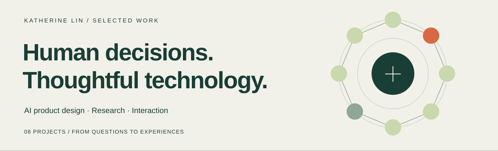
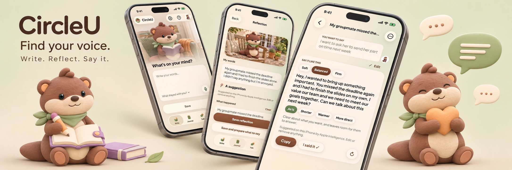
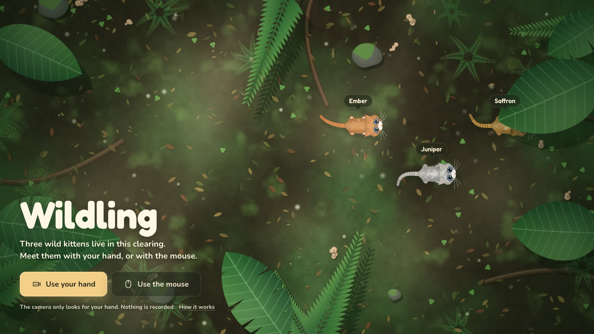
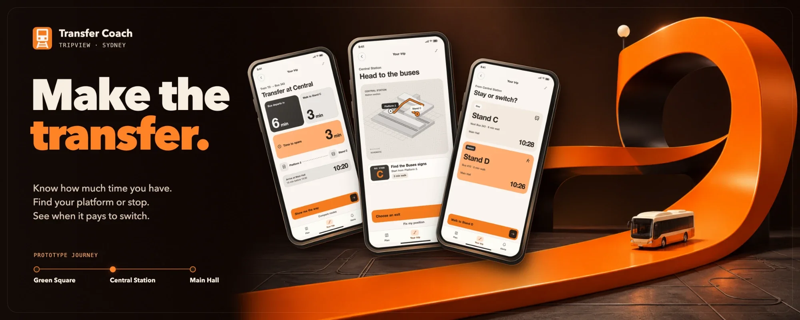
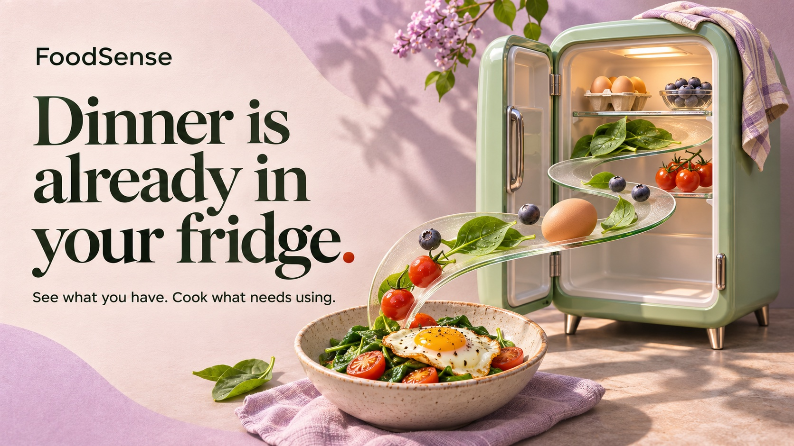
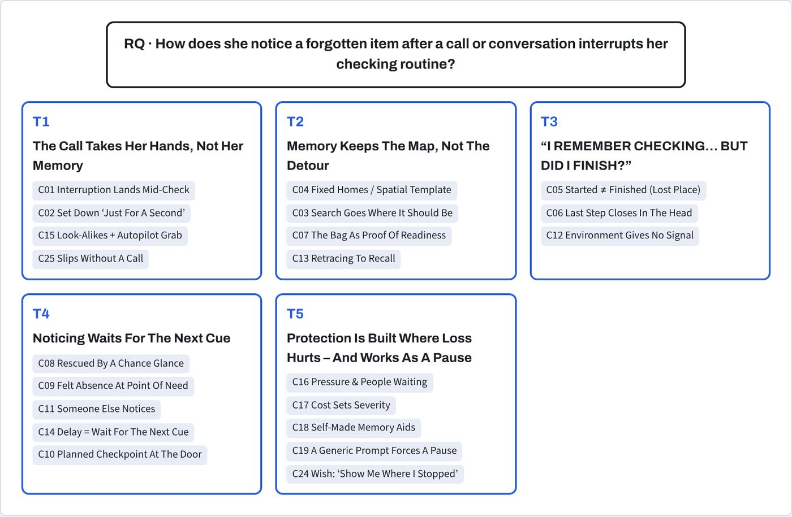
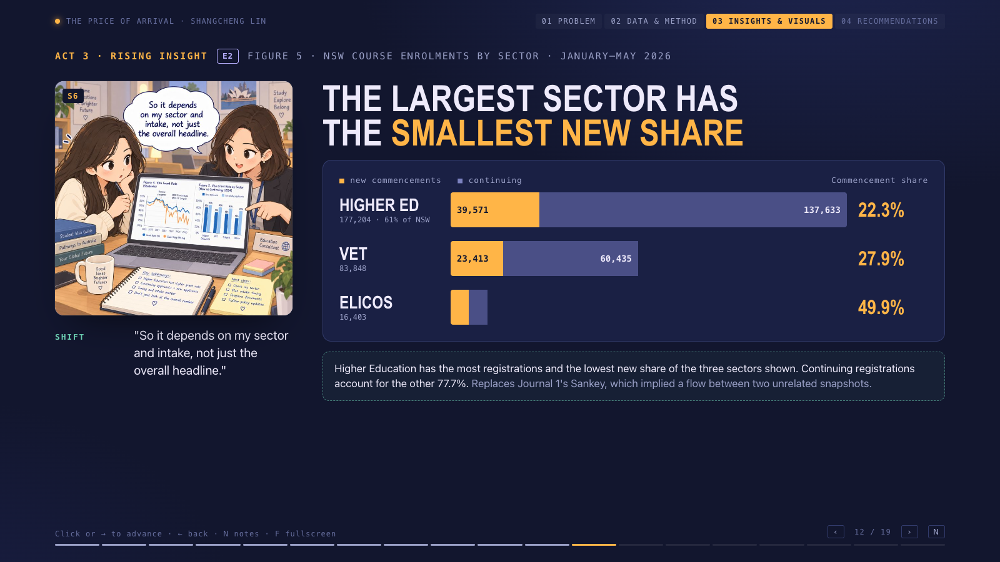

<strong>EN</strong> · <a href="README.zh-CN.md">中文</a>

# Shangcheng Lin (Katherine)

**AI product design · UX research · Interaction design · Creative development**

**[Open the live portfolio](https://katherine0292.github.io/portfolio/)** · [Deployment guide](docs/DEPLOYMENT.md)

I design experiences that help people act when information is uncertain, an interface gets in the way, or a routine breaks. My work connects research, interaction design and working prototypes, from private reflection on an iPhone to explainable creatures in the browser.

This portfolio brings together **eight projects**, including four independent freelance commissions: Wildling, FoodSense, Transfer Coach and The Price of Arrival. Each case study explains the problem, my contribution, the design decisions, the evidence and the current delivery stage.

[GitHub profile](https://github.com/katherine0292) · [All projects](#selected-projects) · [Skills and evidence](#skills-and-evidence) · [Source register](docs/SOURCES.md)

## Where to start

| If you are reviewing… | Start with… |
| --- | --- |
| AI product design and trust | [CircleU](projects/circleu.md), [Wildling](projects/wildling.md), [Who Said What When](projects/who-said-what-when.md) |
| UX, accessibility and recovery | [MusicTag](projects/musictag.md), [Transfer Coach](projects/transfer-coach.md), [FoodSense](projects/foodsense.md) |
| Research and evidence communication | [Remembering in Motion](projects/hci-research.md), [The Price of Arrival](projects/data-visualisation.md) |

## Selected projects

<table>
<tr>
<td width="50%" valign="top">

<h3>01 · CircleU</h3>

<strong>Private reflection, followed by words you can use.</strong>

An iOS journaling and communication experience with on-device AI, editable suggestions and a Write → Reflect → Talk → Outcome loop.

SwiftUI · SwiftData · Apple Foundation Models <strong>Stage:</strong> TestFlight release; current redesign in Simulator testing. <strong>Context:</strong> Team project; product, research, design and development contributions.

<a href="projects/circleu.md">Case study</a> · <a href="https://katherine0292.github.io/CircleU/">Portfolio</a> · <a href="https://github.com/katherine0292/CircleU">Repository</a>

</td>
<td width="50%" valign="top">

<h3>02 · Wildling</h3>

<strong>Meet a creature whose choices you can understand.</strong>

A browser installation where hand gestures and mouse input share one care experience. A visible MIND panel explains each kitten's decisions.

JavaScript · p5.js · MediaPipe · Web Audio <strong>Stage:</strong> Playable V3.1 browser build. <strong>Context:</strong> Independent exhibition commission for Stamp Gallery, a private gallery.

<a href="projects/wildling.md">Case study</a> · <a href="https://katherine0292.github.io/wildling/">Play</a> · <a href="https://github.com/katherine0292/wildling">Repository</a>

</td>
</tr>
<tr>
<td width="50%" valign="top">

<h3>03 · MusicTag</h3>

<strong>Familiar music, within reach.</strong>

An accessible music experience for adults aged 65+, pairing a simplified phone interface with tactile playback and recoverable voice search.

UX research · Accessible interaction · HTML/CSS/JavaScript <strong>Stage:</strong> Browser prototype and 24 design states. <strong>Context:</strong> University–industry collaboration with Spotify.

<a href="projects/musictag.md">Case study</a> · <a href="https://katherine0292.github.io/MusicTag/">Portfolio</a> · <a href="https://github.com/katherine0292/MusicTag">Repository</a>

</td>
<td width="50%" valign="top">

<h3>04 · Transfer Coach</h3>

<strong>A next step when the journey changes.</strong>

A transport decision layer that separates catching the connection from arriving on time, with explicit delay, missed-service and wrong-stop recovery.

UX research · Decision support · Interactive HTML prototype <strong>Stage:</strong> 38-screen prototype and three-method evaluation. <strong>Context:</strong> Independent UX commission for TripView.

<a href="projects/transfer-coach.md">Case study</a> · <a href="https://katherine0292.github.io/Transfer-Coach/portfolio/">Portfolio</a> · <a href="https://github.com/katherine0292/Transfer-Coach">Repository</a>

</td>
</tr>
<tr>
<td width="50%" valign="top">

<h3>05 · Who Said What When</h3>

<strong>Link an answer to its speaker and evidence.</strong>

A conversational audio benchmark pilot that evaluates speaker attribution, answer meaning and supporting time intervals together.

Python · JSONL · Annotation design · Evaluation metrics <strong>Stage:</strong> 0.1.0 pilot; 25 items, with 18 in default evaluation. <strong>Focus:</strong> Auditable data and reproducible scoring.

<a href="projects/who-said-what-when.md">Case study</a> · <a href="https://katherine0292.github.io/who-said-what-when-benchmark/">Walkthrough</a> · <a href="https://github.com/katherine0292/who-said-what-when-benchmark">Repository</a>

</td>
<td width="50%" valign="top">

<h3>06 · FoodSense</h3>

<strong>From what is in the fridge to what to cook.</strong>

An iOS product design concept for reviewing grocery detections, prioritising ingredients and choosing a feasible meal in a shared household.

AI interaction design · iOS UX · Browser prototyping <strong>Stage:</strong> 25 iOS states, 10 paper screens and three prototypes. <strong>Context:</strong> Independent client commission; client not named in the public materials.

<a href="projects/foodsense.md">Case study</a> · <a href="https://katherine0292.github.io/FoodSense/">Portfolio</a> · <a href="https://github.com/katherine0292/FoodSense">Repository</a>

</td>
</tr>
<tr>
<td width="50%" valign="top">

<h3>07 · Remembering in Motion</h3>

<strong>What helps us resume after an interruption?</strong>

A two-phase HCI investigation into bodily checks, belongings and unfinished tasks, moving from interviews to an in-context field probe.

Semi-structured interviews · Affinity analysis · Field probes <strong>Stage:</strong> Research complete; design hypotheses and evaluation plan. <strong>Context:</strong> Personal HCI research.

<a href="projects/hci-research.md">Case study</a> · <a href="https://katherine0292.github.io/HCI-Research/">Portfolio</a> · <a href="https://github.com/katherine0292/HCI-Research">Repository</a>

</td>
<td width="50%" valign="top">

<h3>08 · The Price of Arrival</h3>

<strong>Turn a headline into a decision someone can make.</strong>

An interactive data story about international study in Sydney, connecting course activity, study locations, historical visa context and price trends.

Tableau · Data preparation · Visual storytelling · HTML <strong>Stage:</strong> Six figures, a 19-slide story, film and evaluation workbook. <strong>Context:</strong> Independent data visualisation commission for Harbourline Education Consulting.

<a href="projects/data-visualisation.md">Case study</a> · <a href="https://katherine0292.github.io/Data-Visualisation/">Interactive story</a> · <a href="https://github.com/katherine0292/Data-Visualisation">Repository</a>

</td>
</tr>
</table>

## Skills and evidence

| Capability | How it appears in the work |
| --- | --- |
| Research that changes a design | [HCI Research](projects/hci-research.md): interviews to a field probe; [Transfer Coach](projects/transfer-coach.md): evaluation findings to recovery flows. |
| AI interaction and user control | [CircleU](projects/circleu.md): source labels, fallbacks and editable suggestions; [FoodSense](projects/foodsense.md): review before adding detections. |
| Accessible, recoverable experiences | [MusicTag](projects/musictag.md): tactile controls, stable navigation, voice retry and typing; [Transfer Coach](projects/transfer-coach.md): alternatives at the point of failure. |
| Prototyping and implementation | [Wildling](projects/wildling.md): browser interaction and deterministic replays; [CircleU](projects/circleu.md): native iOS flows and local storage. |
| Evaluation and evidence quality | [Who Said What When](projects/who-said-what-when.md): separate speaker, meaning and time metrics; [The Price of Arrival](projects/data-visualisation.md): definitions, sources and interpretation limits. |

## About this collection

This repository is the portfolio index and case-study collection. The linked project repositories hold their own implementations, research materials, collaborators and licence information. CircleU is a team project; its case study describes my contribution within that team.

Project stages and figures reflect the source snapshots reviewed on **15 November 2026**. Test counts are reported by the source repositories; they were not rerun as part of assembling this collection. Prototype simulations, pilot data and future evaluation work are identified in the individual case studies.

- [`projects/`](projects/) — eight focused case studies.
- [`data/projects.json`](data/projects.json) — a structured project catalogue.
- [`docs/SOURCES.md`](docs/SOURCES.md) — source revisions, evidence links and preview provenance.

**Shangcheng Lin (Katherine)** · [@katherine0292](https://github.com/katherine0292)
