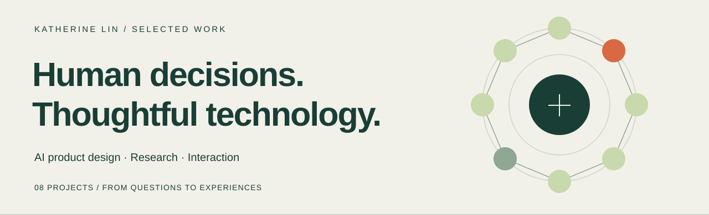
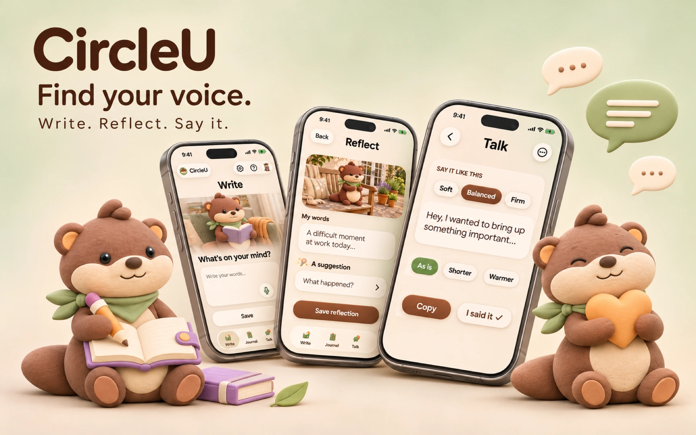
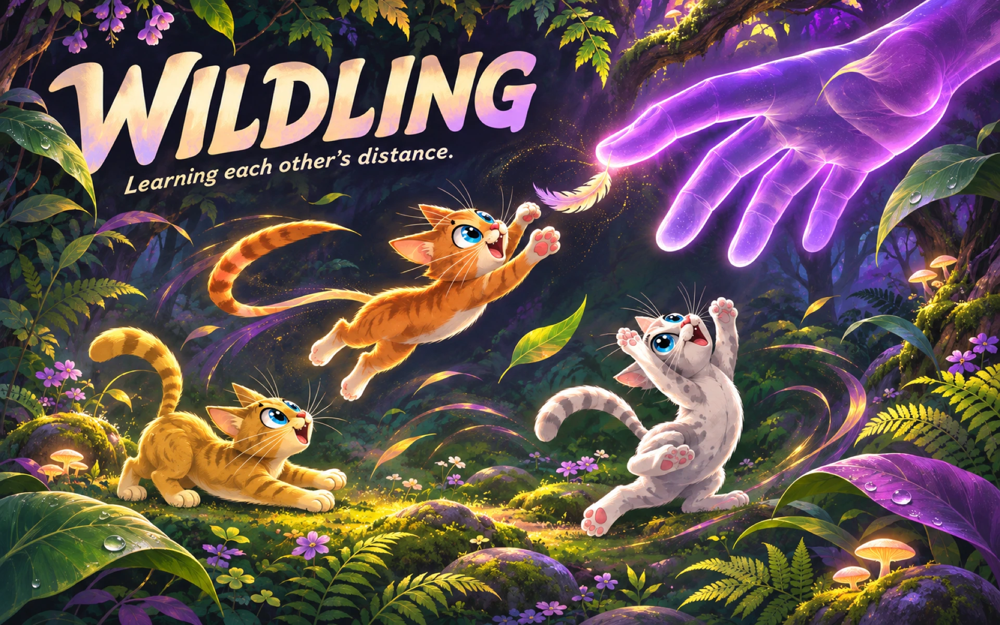
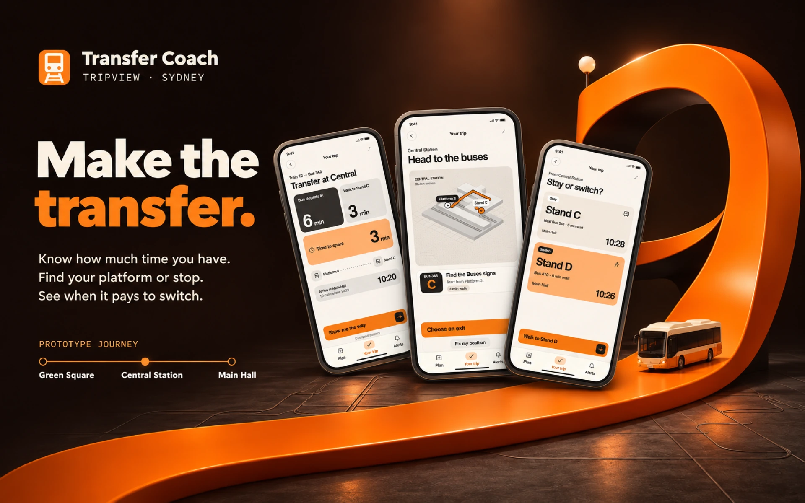
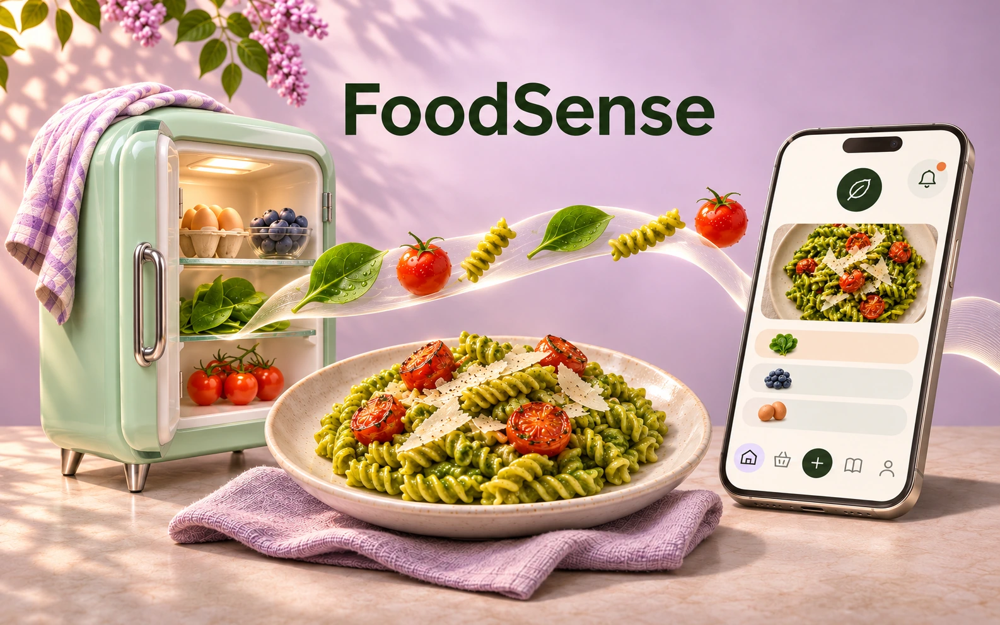

<a href="README.md">EN</a> · <strong>中文</strong>

# Shangcheng Lin (Katherine)

**AI 产品设计 · 用户体验研究 · 交互设计 · 创意开发**

**[打开在线作品集](https://katherine0292.github.io/portfolio/)** · [部署说明](docs/DEPLOYMENT.md)

我关注人们在信息不确定、操作受阻或日常习惯被打断时，如何理解状况并完成下一步。我的项目将研究、交互设计和可运行原型联系起来，覆盖端侧 AI、无障碍体验、公共交通、创意互动、HCI 研究和数据叙事。

这里汇总了 **8 个项目**，其中 Wildling、FoodSense、Transfer Coach 与 Data Visualisation 为独立承接的 freelance 委托；MusicTag 为与 Spotify 合作的校企项目。每个案例均说明问题、个人贡献、关键决策、证据和当前完成范围。

[GitHub 主页](https://github.com/katherine0292) · [英文总览与预览图](README.md#selected-projects) · [来源记录](docs/SOURCES.md)

## 项目总览

<table>
<tr>
<td width="50%" valign="top">

<h3>CircleU</h3>

面向“困难对话”的反思与表达练习 App，基于 Apple 端侧大模型。

<strong>背景:</strong> Apple Foundation Program（悉尼）· 5 人团队，Apple 导师指导 <strong>我的职责:</strong> 产品负责人（PM &amp; UX）：用户研究、MVP 定义、AI 方案、发布 <strong>阶段:</strong> TestFlight 1.0（首个版本）：6 次安装、143 次会话

<a href="https://katherine0292.github.io/CircleU/">作品集</a> · <a href="https://github.com/katherine0292/CircleU">仓库</a>

</td>
<td width="50%" valign="top">

<h3>Wildling</h3>

浏览器互动装置：用手势照顾三只小猫，每只小猫的决策都会实时解释。

<strong>背景:</strong> 委托方：Stamp Gallery（私人画廊）；独立设计与开发 <strong>我的职责:</strong> 独立设计与开发 <strong>阶段:</strong> 已上线 · 真实手势表现待测

<a href="https://katherine0292.github.io/wildling/portfolio/">作品集</a> · <a href="https://katherine0292.github.io/wildling/">试玩</a> · <a href="https://github.com/katherine0292/wildling">仓库</a>

</td>
</tr>
<tr>
<td width="50%" valign="top">

<h3>Transfer Coach</h3>

面向多次换乘通勤的决策层：能否赶上换乘？赶不上时下一步怎么做？

<strong>背景:</strong> 委托方：TripView（悉尼），2026；独立承接 <strong>我的职责:</strong> UX 研究与交互设计（独立完成）：研究、概念、原型与评估 <strong>阶段:</strong> 38 屏原型已交付 · 示例数据，未接入实时数据

<a href="https://katherine0292.github.io/Transfer-Coach/portfolio/">作品集</a> · <a href="https://github.com/katherine0292/Transfer-Coach">仓库</a>

</td>
<td width="50%" valign="top">

<h3>FoodSense</h3>

把冰箱摄像头的识别结果变成经确认的库存，以及一道家里能做的菜。

<strong>背景:</strong> 独立承接的客户委托；公开材料未具名委托方 <strong>我的职责:</strong> UI/UX 设计：交互、视觉与原型 <strong>阶段:</strong> 交互原型 · 识别数据为模拟

<a href="https://katherine0292.github.io/FoodSense/">作品集</a> · <a href="https://github.com/katherine0292/FoodSense">仓库</a>

</td>
</tr>
<tr>
<td width="50%" valign="top">

<h3>MusicTag</h3>

简化的手机界面搭配实体遥控器，帮助老年人自己找到并播放熟悉的音乐。

<strong>背景:</strong> 与 Spotify 合作的校企项目 <strong>我的职责:</strong> UX 与交互设计：研究、原型、语音规范、评估计划 <strong>阶段:</strong> 交互原型 · 语音与蓝牙为模拟 · 可用性测试待开展

<a href="https://katherine0292.github.io/MusicTag/">作品集</a> · <a href="https://github.com/katherine0292/MusicTag">仓库</a>

</td>
<td width="50%" valign="top">

<h3>HCI Research</h3>

两阶段 HCI 研究：人们如何记住随身物品、如何在被打断后恢复日常流程，并提出设计启示。

<strong>背景:</strong> 学术场景下的 HCI 论文研究，2026 · 项目名：Remembering in Motion <strong>我的职责:</strong> 主研究者：问题框定、访谈、分析、探针设计 <strong>阶段:</strong> 两阶段研究完成 · 已提出评估方案

<a href="https://katherine0292.github.io/HCI-Research/">作品集</a> · <a href="https://github.com/katherine0292/HCI-Research">仓库</a>

</td>
</tr>
<tr>
<td width="50%" valign="top">

<h3>Data Benchmark</h3>

音频问答评测试点：检验系统能否同时答对说话人、语义和时间证据。

<strong>背景:</strong> 论文即将发表 · 通讯作者 · 项目名：Who Said What When <strong>我的职责:</strong> 通讯作者 · 任务设计、标注流程、数据校验与评分工具 <strong>阶段:</strong> 评测试点 · 待独立听审

<a href="https://katherine0292.github.io/who-said-what-when-benchmark/">作品集</a> · <a href="https://github.com/katherine0292/who-said-what-when-benchmark">仓库</a>

</td>
<td width="50%" valign="top">

<h3>Data Visualisation</h3>

把国际学生入学数据转化为准留学生可以据此行动的决策。

<strong>背景:</strong> 委托方：Harbourline Education Consulting；独立承接 · 项目名：The Price of Arrival <strong>我的职责:</strong> 数据分析、可视化与叙事，端到端负责 <strong>阶段:</strong> 6 张图表 · 19 页叙事 · 短片

<a href="https://katherine0292.github.io/Data-Visualisation/portfolio/">作品集</a> · <a href="https://github.com/katherine0292/Data-Visualisation">仓库</a>

</td>
</tr>
</table>

## 从能力看作品

| 能力 | 对应项目 |
| --- | --- |
| AI 产品设计、可解释性与用户控制 | CircleU、Wildling、FoodSense |
| 无障碍交互与错误恢复 | MusicTag、Transfer Coach |
| 定性研究与证据综合 | HCI Research、Transfer Coach |
| 原型与工程实现 | CircleU、Wildling、MusicTag |
| 评估设计、数据质量与证据表达 | Data Benchmark、Data Visualisation |

## 阅读说明

本仓库用于集中展示作品与案例。完整代码、研究材料、协作者和许可说明保留在各自原仓库中。CircleU 的团队背景与个人贡献在案例中单独说明。

内容核对日期为 **2026 年 11 月 15 日**。测试数量取自源仓库记录，本次汇总未重新运行各项目的测试。原型模拟、待验证假设和后续计划均按实际状态标注。

- [八个案例](projects/README.md)
- [结构化项目目录](data/projects.json)
- [来源版本与预览图出处](docs/SOURCES.md)

**Shangcheng Lin (Katherine)** · [@katherine0292](https://github.com/katherine0292)
