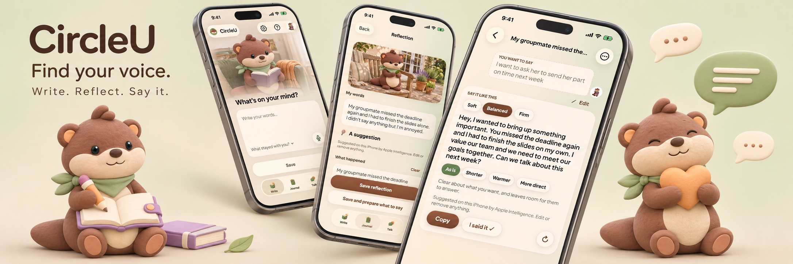

[← Portfolio](../README.md) · [中文总览](../README.zh-CN.md)

# CircleU

**Turn a difficult moment into reflection, words and a next step.**

| | |
| --- | --- |
| Context | Team project in the Apple Foundation Program 2026 |
| My contribution | Product definition, discovery and usability research, AI experience, UI/UX and core-screen development |
| Platform | iPhone; SwiftUI, SwiftData, Foundation Models, Speech and AVFoundation |
| Delivery | Earlier version shipped to TestFlight; the current guest-first redesign is in Simulator testing |

## Problem and direction

People can replay a difficult conversation and still be unsure what to say next. CircleU connects journaling to communication through one loop: **Write → Reflect → Talk → How did it go?** A saved moment keeps the original entry, reflection, conversation and outcome together.

## My work

I helped shape the concept, led discovery research and usability work, defined the MVP and user stories, and contributed across the product's iterations. My design work moved the experience from an account-led structure toward a focused guest experience with three tabs: Write, Journal and Talk.

The AI interaction separates a person's words from suggestions. Reflections are editable. Talk offers tone choices, alternate wording and two possible readings of a reply, with a “Neither fits” path. The moment timeline and outcome check close the loop after the conversation.

## Decisions that matter

- **Keep sensitive reflection on the phone.** The current guest experience uses local SwiftData storage and on-device Foundation Models. The legacy release has a separate Firebase-backed architecture.
- **Keep the core task available.** Guided prompts work when the model is unavailable; source labels explain what produced a suggestion.
- **Keep interpretation with the person.** Alternate readings and explicit confirmation avoid presenting a model's guess as another person's intention.
- **Reduce first-use effort.** Guest entry and a skippable, contextual guide introduce the next action in place.

## Evidence and current scope

The source portfolio reports 20 discovery participants and 10 usability sessions. It records reflection task completion changing from 6/10 to 9/10 in a retest after design revisions. These are project-reported observations from small sessions.

The reviewed source reports **311 unit tests and 28 UI tests**. This collection does not rerun them. The current guest redesign and the earlier TestFlight release are distinct delivery stages.

CircleU was built with a team. The [original team repository](https://github.com/tuannm3812/CircleU) and the project's own credits retain that context.

## Explore

- [Visual portfolio](https://katherine0292.github.io/CircleU/)
- [Project repository](https://github.com/katherine0292/CircleU)
- [Architecture and version boundaries](https://github.com/katherine0292/CircleU/blob/main/docs/product/how-circleu-works.md)
- [User stories and acceptance criteria](https://github.com/katherine0292/CircleU/blob/main/docs/product/user-stories.md)
- [AI acceptance cases](https://github.com/katherine0292/CircleU/blob/main/docs/qa/ai-acceptance-cases.md)

**中文摘要：** 团队 iOS 项目。我参与研究、产品定义、AI 交互、界面设计与开发，将记录、反思、沟通和结果回顾串成闭环。当前改版采用本地存储、端侧建议与可用的降级路径；其模拟器测试阶段与早期 TestFlight 版本分别说明。

[Source snapshot and preview provenance](../docs/SOURCES.md#circleu)
