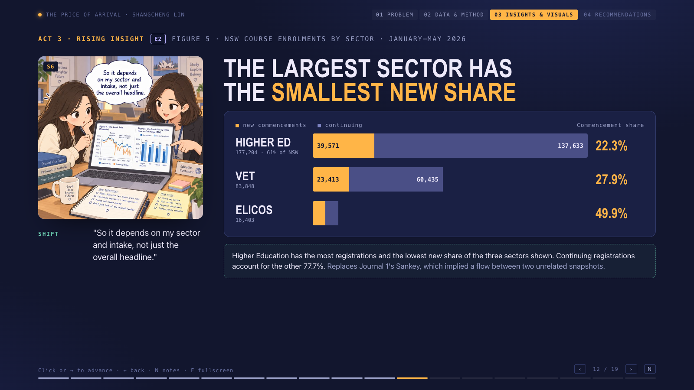

[← Portfolio](../README.md) · [中文总览](../README.zh-CN.md)

# The Price of Arrival

**An international-study headline becomes a story about decisions.**

| | |
| --- | --- |
| Context | Independent data visualisation commission for Harbourline Education Consulting |
| My role | Data visualisation designer and data storyteller, from sourcing through delivery |
| Tools and methods | Public aggregate datasets, Tableau, personas, storyboarding and interactive HTML |
| Delivery | 5 public datasets, 6 figures, a 19-slide presentation with 10 illustrated scenes, film and evaluation workbook |

## Problem and direction

A record enrolment headline says little about a prospective student's intake, campus location or budget. I structured the story around Mei, a prospective Master's student, and the questions she needs to answer before choosing international study in Sydney.

## My work

I sourced and prepared the data, reconciled periods and geographic scopes, designed the six figures, developed audience personas and user stories, and built the presentation and companion film. Definitions and limits travel with the figures so readers can interpret them without the narration.

## Decisions that matter

- **Separate counts that answer different questions.** Course enrolments and commencements describe different parts of the system.
- **Make smaller study hubs visible.** Logarithmic colour scales support the location and field comparisons; suppressed observations remain missing.
- **Avoid implying a flow the data cannot identify.** I replaced an early Sankey concept with sector composition bars and new-share labels.
- **Keep indices within their meaning.** Price trends support discussion of change. I removed a proposed personal budget calculator because CPI could not support individual dollar estimates.
- **Order the narrative by decisions.** The story moves through intake, study location, historical visa context and affordability, ending with concrete checks for the persona.

## Evidence and current scope

The source repository documents 2019–2026 project snapshots and figure-specific definitions. These are descriptive historical analyses. They do not estimate an individual's visa outcome, and the narrative does not establish causal policy effects.

The evaluation workbook contains self-assessment and proposed audience checks; its targets are not observed user results. Some original extracts and the Tableau workbook are unavailable in the supplied materials, which limits independent reproduction.

## Explore

- [Open the interactive story](https://katherine0292.github.io/Data-Visualisation/)
- [Project repository](https://github.com/katherine0292/Data-Visualisation)
- [Interactive story HTML source](https://github.com/katherine0292/Data-Visualisation/blob/main/index.html)
- [Design process and contribution](https://github.com/katherine0292/Data-Visualisation/blob/main/docs/design-process.md)
- [Data methodology and figure limits](https://github.com/katherine0292/Data-Visualisation/blob/main/docs/methodology.md)
- [Commission brief](https://github.com/katherine0292/Data-Visualisation/blob/main/docs/commission-brief.md)
- [Evaluation workbook](https://github.com/katherine0292/Data-Visualisation/blob/main/artifacts/story-benchmark.xlsx)

Clone or download the project and open `index.html` in a desktop browser. Use the arrow keys for slides and reveals, **N** for notes and **F** for fullscreen.

**中文摘要：** 为 Harbourline Education Consulting 独立承接的数据可视化与叙事委托，用六幅图帮助读者区分课程总量、新开课程、学习地点和价格趋势。重点在于定义清楚、选择合适图表，并将解释范围与数据来源一同呈现。评估目标与实际结果分别标注。

[Source snapshot and preview provenance](../docs/SOURCES.md#data-visualisation)
