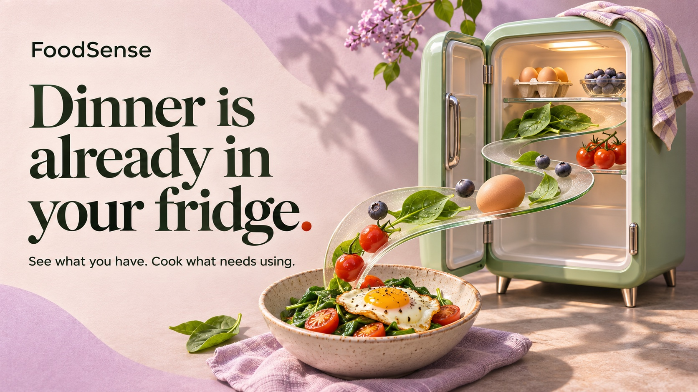

[← Portfolio](../README.md) · [中文总览](../README.zh-CN.md)

# FoodSense

**Know what is there. Decide what to use. Cook a feasible meal.**

| | |
| --- | --- |
| Context | Independent client commission |
| My role | UI/UX designer: synthesis, interaction and visual design, prototyping |
| Audience | Budget-conscious international residents sharing limited fridge space in Sydney |
| Delivery | 10 paper screens, 25 iOS design states in 4 flows, and 3 clickable prototypes |

## Problem and direction

In a shared fridge, groceries disappear behind other items and manual inventory becomes another task to maintain. FoodSense focuses on one finishable decision: confirm the ingredients available, see what to use first and choose a meal that fits.

The concept pairs an iPhone interface with Javic, a proposed in-fridge camera. Detection enters the experience as a draft for the cook to review.

## My work

I synthesised two client-supplied interview records into a composite persona and dinner scenario, then designed the path from grocery entry through inventory and recipe choice to cooking. Iterations include paper screens, an early browser demo, an interaction exploration and the final iOS-style prototype.

## Decisions that matter

- **Confirm before adding.** People can select, skip and correct candidate groceries; manual entry remains available.
- **Connect reminders to action.** “Use first” links ingredients to feasible recipes rather than ending at a date alert.
- **Explain a recipe match.** Time, ingredient coverage and missing items appear before the cook commits.
- **Protect edits.** A later scan should not overwrite corrected inventory; pantry removal after cooking needs confirmation.
- **Keep uncertainty visible.** Recorded dates and proposed sensor cues are separate. The interface does not claim a cue establishes food safety.

## Evidence and current scope

The prototypes support pantry edits, saved recipes, shopping lists, cooking steps and timers in the browser. Detection results, device output and recipe ranking use sample data. The recognition model, electronic nose and live device sync were not built.

Two interview records guide design hypotheses rather than prevalence claims. Moderated correction and meal-selection tasks, followed by an in-home pilot, are proposed. Waste and cost reductions remain unmeasured hypotheses.

## Explore

- [Visual portfolio](https://katherine0292.github.io/FoodSense/)
- [Try the final iOS-style prototype](https://katherine0292.github.io/FoodSense/prototypes/ios/index.html)
- [Project repository](https://github.com/katherine0292/FoodSense)
- [Portfolio HTML source](https://github.com/katherine0292/FoodSense/blob/main/index.html)
- [Final prototype source](https://github.com/katherine0292/FoodSense/blob/main/prototypes/ios/index.html)
- [Design case study](https://github.com/katherine0292/FoodSense/blob/main/docs/case-study.md)
- [Product proposal and boundaries](https://github.com/katherine0292/FoodSense/blob/main/docs/product-proposal.md)
- [Delivery walkthrough](https://github.com/katherine0292/FoodSense/blob/main/docs/delivery.md)

Clone the source repository and open `index.html` for the portfolio or `prototypes/ios/index.html` for the final prototype.

**中文摘要：** 独立客户委托，围绕共享冰箱中的库存核对、优先使用和做饭决策设计 iOS 体验。识别结果必须由使用者确认。当前为可交互原型，识别硬件与模型尚未实现，减少浪费和费用的效果仍待验证。

[Source snapshot and preview provenance](../docs/SOURCES.md#foodsense)
