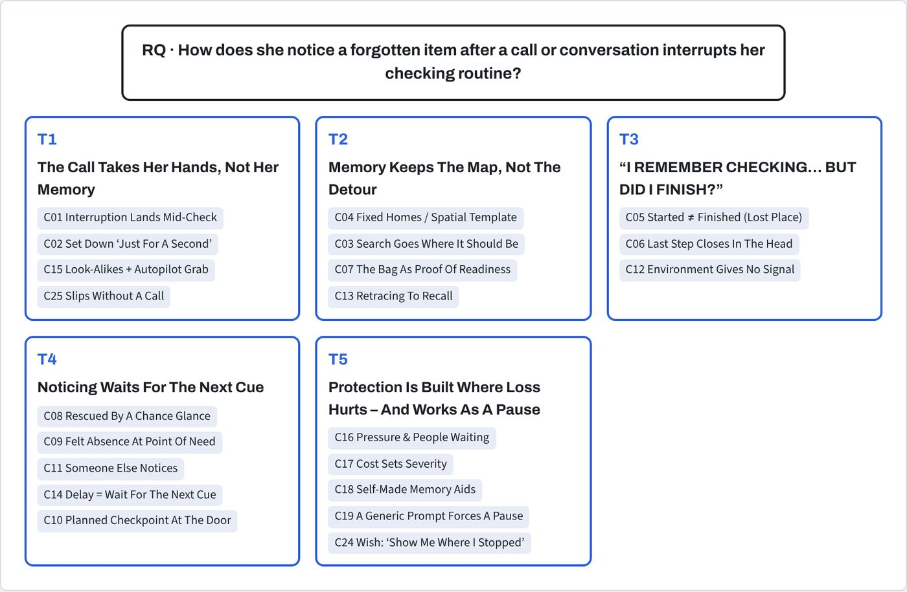

[← Portfolio](../README.md) · [中文总览](../README.zh-CN.md)

# Remembering in Motion

**Everyday memory, interrupted routines and the next unfinished step.**

| | |
| --- | --- |
| Context | Personal HCI research project, 2026 |
| My role | Research framing, interviews, qualitative analysis, probe design, synthesis and design opportunities |
| Methods | Semi-structured interviews, affinity analysis, participatory location mapping and a field probe |
| Delivery | Two research phases, instruments, evidence summaries and an evaluation proposal |

## Research question

How do people remember belongings while moving between everyday places, and how do they recover when an interruption displaces a familiar check?

The research distinguishes losing an object's temporary location from losing progress through an unfinished task. Those failures can need different design responses.

## Phase 1 · When the Body Remembers

Interviews with **15 participants** produced **356 coded entries, 26 clusters and 6 themes**. Bags, pockets and fixed locations could stand in for a list of belongings. Pocket pats, weight and a last glance helped people check readiness. An unusual item or a call could interrupt that routine.

I used exceptions and counterexamples to refine the field question, focusing on what cue someone encountered next and how it enabled recovery.

## Phase 2 · Interrupted Rituals

A **two-week probe with one property manager** recorded **10 incidents** through short messages, voice notes, photos and reactions. A map of usual item locations supplied context.

At handoff, the participant declined a keyring prompt because of its bulk. I moved the prompt to an eraser she could keep at her desk or in her bag. The adjustment kept participation compatible with her working day.

The field analysis distinguishes visible item state from less visible task state: finding keys could be resolved by a glance, while uncertainty about a completed document check led to repetition. A prepared but unsent bill showed why unfinished work needs a cue at resumption.

## Evidence and design implications

The studies led to evidence-linked concepts for surfacing temporary locations and the next unfinished step. These are design hypotheses with a proposed evaluation, rather than validated product outcomes.

The 15-person interview analysis and the single-participant field probe are separate samples and analyses. The field phase offers depth, with limited generalisation. This collection links aggregate findings and instruments; original transcripts and chat logs stay with the study materials.

## Explore

- [Bilingual visual portfolio](https://katherine0292.github.io/HCI-Research/)
- [Project repository](https://github.com/katherine0292/HCI-Research)
- [Interview study](https://github.com/katherine0292/HCI-Research/blob/main/research/interview-study.md)
- [Field probe study](https://github.com/katherine0292/HCI-Research/blob/main/research/field-probe-study.md)
- [Research instruments](https://github.com/katherine0292/HCI-Research/blob/main/methods/research-instruments.md)
- [Design opportunities](https://github.com/katherine0292/HCI-Research/blob/main/research/design-opportunities.md)

**中文摘要：** 两阶段 HCI 研究，从 15 人访谈转向单参与者两周探针，区分“物品放在哪里”与“任务做到哪一步”。研究提出在恢复工作时显示下一未完成步骤的设计假设，尚待进一步评估。

[Source snapshot and preview provenance](../docs/SOURCES.md#hci-research)
