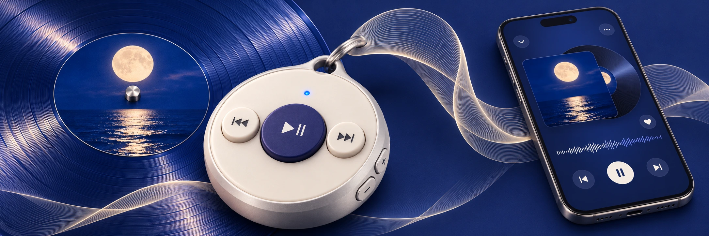

[← Portfolio](../README.md) · [中文总览](../README.zh-CN.md)

# MusicTag

**Familiar music. Within reach.**

| | |
| --- | --- |
| Context | University–industry collaboration with Spotify |
| My role | Research, synthesis, interaction design, prototyping, voice specification and evaluation planning |
| Audience | Listeners aged 65+ with varied digital confidence, vision, dexterity and language needs |
| Delivery | Working browser prototype, bilingual portfolio and 24 design states |

## Problem and direction

Familiar listening routines break when saved songs become hard to find, controls change, or a voice request is misunderstood. MusicTag combines predictable phone navigation with a tactile remote for repeated playback actions.

The phone chooses songs, playlists and audio output. The five-control remote handles playback and volume. A persistent mini-player keeps listening accessible while browsing.

## My work

I led the research, synthesis and interaction design, defined the phone–remote split, and developed flows for listening, voice recovery, family playlists, preferences and setup. The evidence includes a 13-source literature catalogue, a five-service comparison, two traceable firsthand interviews and an early walkthrough.

## Decisions that matter

- **Return to a stable place.** Home, Library, last played and pinned favourites make music easier to recover.
- **Let the listener choose.** Voice proposes identifiable title and artist matches before playback.
- **Make failure actionable.** Retry, typing and returning to Library remain available after a missed request or offline search.
- **Teach by trying.** Remote setup includes guided playback-button practice and visible feedback.
- **Keep responsibilities legible.** Speaker selection stays on the phone; the remote controls playback and has no speaker.

## Evidence and current scope

The browser demonstrates navigation, synthesised playback, preferences and selected recovery paths. Voice input, Bluetooth pairing, invitations and speaker switching are simulations. Production catalogue integration and firmware are outside the delivery.

The next evaluation asks intended listeners to recover familiar songs, retry a missed request and operate the remote independently. Current-design usability outcomes, physical ergonomics, Bluetooth reliability and recognition across language conditions remain to be established.

## Explore

- [Visual portfolio](https://katherine0292.github.io/MusicTag/)
- [Project repository](https://github.com/katherine0292/MusicTag)
- [Project brief](https://github.com/katherine0292/MusicTag/blob/main/docs/project-brief.md)
- [Evaluation documentation](https://github.com/katherine0292/MusicTag/blob/main/docs/evaluation.md)

**中文摘要：** 与 Spotify 合作的校企项目，负责 UX 与交互设计。面向 65 岁以上听众。以稳定的手机导航、触觉播放控制和可恢复语音搜索降低操作负担。当前交付为原型与规范，蓝牙、语音和生产服务尚未接入。

[Source snapshot and preview provenance](../docs/SOURCES.md#musictag)
