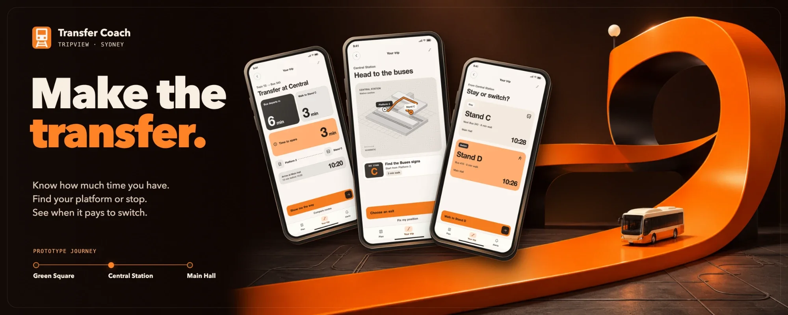

[← Portfolio](../README.md) · [中文总览](../README.zh-CN.md)

# Transfer Coach

**Designing for the three minutes that decide a commute.**

| | |
| --- | --- |
| Context | Independent commissioned UX project for TripView, 2026 |
| My role | UX researcher and interaction designer from research through evaluation |
| Methods | Interviews, affinity mapping, journey mapping, iterative prototyping, heuristic and user evaluation |
| Delivery | 38-screen high-fidelity prototype with disruption branches and design notes |

## Problem and direction

A route plan made at home gives little help when a service is late or a commuter reaches the wrong stop. Transfer Coach answers three distinct questions: **Can I catch it? Will I arrive on time? What should I do now?**

The feature is a decision layer on existing transport information. It connects walking time and transfer margin to the destination deadline, and makes a recovery route ready to start.

## My work

I took the project through research synthesis, a persona and journey map, two concepts, low-, mid- and high-fidelity prototypes, and evaluation. The final browser prototype connects all 38 screens, including delayed services, missed trains and buses, wrong stops and position recovery.

## Decisions changed by evidence

- A stop display and the prototype disagreed about delay. I added an explicit delayed state with the previous time, new time, delay amount and updated destination arrival.
- “Transfer complete” appeared before boarding. I changed the status to “You're at Stand C”.
- Backup options were hard to compare. Arrival time and the margin before the event now lead the options.
- Station instructions felt technical. Landmarks, pictograms and “Fix my position” support recovery when GPS is unhelpful.
- Route selection led to a dead end. Choosing an alternative now starts guidance.

## Evidence and current scope

Evaluation combined a heuristic review, **7 moderated usability sessions across 3 scenarios**, and **2 structured experience journals**. Of 13 usability recommendations, the source records 8 fully implemented, 4 partly implemented and 1 open.

All routes, timings and disruptions use sample data. No live feed or prediction model is connected. The project demonstrates decision support and recovery design; predictive accuracy and operational transport performance are outside the evidence.

## Explore

- [Visual portfolio](https://katherine0292.github.io/Transfer-Coach/portfolio/)
- [Project repository](https://github.com/katherine0292/Transfer-Coach)
- [Interactive prototype source](https://github.com/katherine0292/Transfer-Coach/blob/main/prototype/index.html)
- [Research](https://github.com/katherine0292/Transfer-Coach/blob/main/docs/02-research.md)
- [Evaluation](https://github.com/katherine0292/Transfer-Coach/blob/main/docs/06-evaluation.md)
- [Outcomes and next steps](https://github.com/katherine0292/Transfer-Coach/blob/main/docs/07-outcomes-and-next-steps.md)

**中文摘要：** 独立委托 UX 项目。针对换乘中的延误、错过班次和位置错误，将赶上交通工具与准时到达目的地分开表达，并提供可以立即开始的恢复路线。38 屏原型和评估均使用演示数据。

[Source snapshot and preview provenance](../docs/SOURCES.md#transfer-coach)
