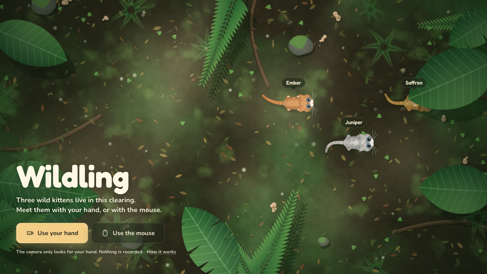

[← Portfolio](../README.md) · [中文总览](../README.zh-CN.md)

# Wildling

**An explainable creature experience you meet with your hand.**

| | |
| --- | --- |
| Context | Independent exhibition interaction commission for Stamp Gallery, a private gallery |
| My role | AI product and interaction designer, developer |
| Tools | Plain ES modules, p5.js, MediaPipe Hand Landmarker, Web Audio |
| Delivery | Playable V3.1 browser build with hand, mouse and touch interaction |

## Problem and direction

A visitor needs to understand both how to interact and why a creature responds. When tracking fails, a character's refusal can otherwise look like a broken interface. Wildling makes input reliability and creature choice visible as separate events.

Three kittens share a habitat, each with its own needs. Visitors can stroke, feed, play and offer water. A persistent **MIND** panel shows the nearest kitten's needs, candidate behaviours, blocked reasons and selected action.

## My work

I developed the briefs and product requirements, designed the interaction and behaviour, built the browser experience, and documented decisions and evaluation. Across versions, I simplified entry from choosing tools and a kitten to using the hand directly with the whole litter.

## Decisions that matter

- **One interaction contract.** Hand and mouse routes provide the same actions, which also makes the installation accessible without a camera.
- **Explain refusal.** A tired or hungry kitten gives a reason. Lost tracking stops contact and carries no trust penalty.
- **Separate model and rules.** A pretrained model supplies hand keypoints; geometric rules interpret gestures; hard constraints and utility functions select behaviour.
- **Show the actual decision.** The panel and deterministic replays read the same recorded causes, rather than generating an explanation afterwards.
- **Keep camera processing local.** The browser processes input on the device.

## Evidence and current scope

The source reports **119 deterministic replay tests across 19 suites**, covering product logic, invalid tracking, gesture features and multi-kitten behaviour. Scripted browser recordings demonstrate the interactions.

Recognition performance with real hands at venue lighting and distance remains to be measured. Synthetic landmark tests support implementation checks; they do not establish a real-world accuracy rate. The current V3.1 description takes precedence over older prototype documentation when components differ.

## Explore

- [Play Wildling](https://katherine0292.github.io/wildling/)
- [Visual portfolio](https://katherine0292.github.io/wildling/portfolio/)
- [Project repository](https://github.com/katherine0292/wildling)
- [V3 experience specification](https://github.com/katherine0292/wildling/blob/main/docs/design/experience-spec-v3.md)
- [AI capability boundaries](https://github.com/katherine0292/wildling/blob/main/docs/ai-boundaries.md)
- [Usability study plan](https://github.com/katherine0292/wildling/blob/main/docs/research/usability-test-plan.md)

**中文摘要：** 受私人画廊 Stamp Gallery 委托，独立完成产品与交互设计、浏览器开发。用手势或鼠标与三只小猫互动。重点在于让追踪状态、角色需求和拒绝原因都可以理解。项目将预训练手部模型、规则、效用决策和统计适应分开描述；真实场地的识别率仍待测量。

[Source snapshot and preview provenance](../docs/SOURCES.md#wildling)
